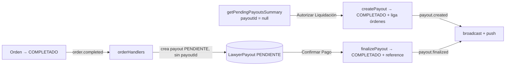

# 03g — Feature: finance

> Documento basado en lectura directa del código real. Cada afirmación cita
> `ruta:línea`. Cuando algo no puede confirmarse se marca **A verificar**.

---

## 1. Propósito

`features/finance` es el **ViewModel/Model transversal de dinero** de la app.
Agrupa tres responsabilidades que no forman una entidad de dominio única:

1. **KPIs y desglose financiero** (comisión de abogado, gastos operativos,
   impuestos, fee de plataforma, neto) para admin y abogado
   (`actions/getFinancialSummary.ts`).
2. **Liquidaciones a abogados** (`LawyerPayout`): consulta de pendientes,
   creación/agrupación, finalización e historial (`actions/payoutActions.ts` +
   `components/*` + `hooks/usePayoutManagement.ts`).
3. **Configuración de visualización de precios**: la tasa USD→PEN y el flag
   global `show_usd_prices` se exponen aquí como hooks de cliente
   (`hooks/useExchangeRate.ts`, `hooks/useDisplaySettings.ts`).

La feature **no tiene barrel** `index.ts` (confirmado: no existe) y **no es
dueña** de la escritura de la configuración financiera: eso vive en
`features/financial-settings` (ver §10).

---

## 2. Inventario

| Archivo | Exports | Importadores |
|---------|---------|--------------|
| `actions/getFinancialSummary.ts` | `FinancialSummaryFilters` (tipo), `getFinancialSummary(filters, user)` | `components/admin/hooks/useDashboardStats.ts:8`, `components/admin/hooks/useFinanzasPanel.ts:4`, `components/abogado/hooks/useAbogadoPanel.ts:8`, `components/abogado/hooks/useFacturacionPanel.ts:4`, `components/abogado/AbogadoPanel.tsx:32`, `hooks/useAbogadoData.ts:5` |
| `actions/payoutActions.ts` | `getPendingPayoutsSummary`, `createPayout`, `finalizePayout`, `getPayoutHistory` | `hooks/usePayoutManagement.ts:3-8`, `components/abogado/hooks/useFacturacionPanel.ts:5`, `components/finance/components/PayoutHistoryList.tsx:4` |
| `actions/paymentActions.ts` | `createOrderInDB`, `updateOrderPaymentStatus` | **0 importadores** (código muerto) |
| `components/PayoutManagement.tsx` | `default PayoutManagement` | `components/admin/FinanzasPanel.tsx:18,318` |
| `components/PayoutHistoryList.tsx` | `default PayoutHistoryList` | `components/abogado/FacturacionPanel.tsx:22,165` |
| `hooks/usePayoutManagement.ts` | `usePayoutManagement` | `components/PayoutManagement.tsx:5` |
| `hooks/useExchangeRate.ts` | `useExchangeRate` | `components/ui/DualPrice.tsx:5`, `features/checkout/components/CheckoutModal.tsx:19`, `features/checkout/components/ServiceSummary.tsx:7`, `components/admin/hooks/useServiciosPanel.ts:10` |
| `hooks/useDisplaySettings.ts` | `displaySettingsKeys`, `useDisplaySettings`, `useUpdateDisplaySettings` | `components/ui/DualPrice.tsx:6`, `components/admin/ConfiguracionPanel.tsx:22`, `hooks/useDisplaySettingsRealtime.ts:25` |

> No hay consumidores que importen de un barrel `@/features/finance`; todos
> importan rutas internas (`@/features/finance/...`). El único import con path
> relativo es `PayoutManagement.tsx` → `../hooks/usePayoutManagement`
> (`PayoutManagement.tsx:5`).

---

## 3. Modelo financiero

### 3.1 `Order` — campos financieros (`prisma/schema.prisma:54-98`)

- `total Decimal(10,2)` (`:61`), `totalPen Decimal?` (`:62`),
  `exchangeRateUsed Decimal(10,4)?` (`:63`): congelan el precio y la tasa
  usada en el momento de la compra (trazabilidad).
- Desglose persistido: `commissionAmount` (`:67`), `operationalCostAmount`
  (`:68`), `platformFeeAmount` (`:69`), `taxAmount` (`:70`),
  `netProfitAmount` (`:71`).
- `payoutId String?` + relación `payout LawyerPayout? @relation("OrderToPayout")`
  con `onDelete: SetNull` (`:85-86`). Índice compuesto
  `@@index([activo, status, payoutId, lawyerId])` (`:97`) que soporta la
  consulta de pendientes.

### 3.2 Fórmula del desglose (`services/finance.service.ts:15-45`)

`calculateOrderFinances(total, settings)` (Decimal de `@prisma/client`):

```
comisionAbogado   = total * lawyer_commission_percentage / 100
gastosOperativos  = total * operational_costs_percentage / 100
impuestos         = total * tax_percentage / 100
platformFee       = total * platform_fee_percentage / 100
netoPlataforma    = total - comisionAbogado - gastosOperativos - impuestos - platformFee
```

Con `toDecimalPlaces(2)` en cada deducción (`:29-32`). Si un porcentaje es 0,
la deducción es 0 (`:12-14, 23-26`). El comentario jefe del archivo dice
"Neto_Plataforma = Total - (Comisión + Gastos + Impuestos)" pero el código
**también resta `platformFee`** (`:35`): documentación desactualizada.

`aggregateFinancials` (`:51-77`) hace lo mismo sobre una colección y suma
`platformFee` dentro de `taxes` (`:66`).

**Dónde se aplica**: al crear `Order` (`api/orders/route.ts:160`,
`api/orders/admin-create/route.ts:114`), al listar órdenes
(`api/orders/route.ts:108`) y al leer historial (`features/orders/actions/getOrdersHistory.ts:102`).

`getFinancialSummary` **no** llama a `calculateOrderFinances`: replica la
fórmula en SQL (`getFinancialSummary.ts:27`) para agregar sin cargar filas.

### 3.3 `FinancialSettings` (`prisma/schema.prisma:110-123`)

Singleton (`@@map("FinancialSettings")`) con `lawyer_commission_percentage`
(default 70), `operational_costs_percentage` (10), `tax_percentage` (15),
`platform_fee_percentage` (5), `simulation_base`, `usd_pen_fallback_rate`,
`whatsappPhone` (columna `whatsapp_phone`), `updated_at`, `updated_by`.

`lib/getFinancialSettings.ts:17-41` expone `getFinancialSettingsCached()`:
normaliza a `number` y cachea 30 s bajo `'financial-settings'`; si no existe
fila, devuelve todos los porcentajes en 0.

### 3.4 `DisplaySettings` (`prisma/schema.prisma:125-132`)

Singleton `@@map("DisplaySettings")` con `show_usd_prices Boolean @default(true)`.
Controla la visibilidad global de montos USD.

### 3.5 `LawyerPayout` (`prisma/schema.prisma:212-235`)

`PayoutStatus = PENDIENTE | COMPLETADO | RECHAZADO` (`:212-216`).
`LawyerPayout` (`@@map("LawyerPayouts")`): `lawyerId`, `amount Decimal(10,2)`,
`status` (default `PENDIENTE`), `method`, `reference`, `notes`, `paidAt`,
`createdAt/updatedAt/deletedAt`, `lawyer User` (`onDelete: Restrict`) y
`orders Order[]` (relación inversa de `OrderToPayout`).

---

## 4. Detalle por archivo

### 4.1 `actions/getFinancialSummary.ts` (`'use server'`)

- **Propósito**: Server Action que calcula KPIs financieros por rol y rango de
  fecha (`:24-29`).
- **Exports**: `interface FinancialSummaryFilters` (`:8`),
  `getFinancialSummary(filters, user)` (`:29`).
- **Imports**: `prisma` (`:3`), `UserRole` (`:4`), `serializeFinance` (`:5`),
  `getFinancialSettingsCached` (`:6`).
- **Efectos secundarios**: ninguna escritura; solo lecturas (`$queryRaw`).
- **Lógica**:
  - Lee settings (caché 30 s) y extrae los 4 porcentajes (`:33-37`).
  - Convierte `dateRange` (`today|week|month|year|all`) a `dateFrom` (`:40-62`);
    `'all'` deja `dateFrom = null`.
  - **Autorización por rol**: `effectiveLawyerId = role==='ABOGADO' ? user.id :
    role==='ADMIN' ? (lawyerId||null) : null` (`:65-66`). Un cliente no puede
    filtrar por abogado.
  - Query 1 (`:70-83`): `SUM(total)` como `totalIncome`, y
    `ROUND(total * pct/100, 2)` por cada porcentaje sobre órdenes
    `activo = true` con status en `PENDIENTE, EN_PROGRESO, REVISION, COMPLETADO`
    (excluye `PAID`, `PAGO_PENDIENTE`, etc.).
  - Query 2 (`:86-96`): `pendingLawyerPayments` = `SUM(commissionAmount)` de
    órdenes `COMPLETADO` con abogado y **sin payout liquidado**
    (`o.payoutId IS NULL OR p.status IS DISTINCT FROM 'COMPLETADO'`), vía
    `LEFT JOIN "LawyerPayouts"` (`:89,93`).
  - Calcula `realProfit = totalIncome - totalCommissions - totalExpenses`
    (`:107`), con `totalExpenses = ops + taxes + fees` (`:100`).
  - Añade campos solo para `ABOGADO`: `lawyerPendingBalance`, `lawyerTotalEarned`
    (`:110-111`). Expone `settings` con los porcentajes (`:112-117`).
  - Serializa con `serializeFinance` para poder cruzar a Client Components
    (`:121`).
- **Errores**: envuelve todo en `try/catch`, loguea con etiqueta
  `[DATABASE_REPAIR]` (`:123`) y relanza mensaje amigable (`:133`).
- **Importadores**: ver §2 (admin dashboard, finanzas, abogado, facturación).

### 4.2 `actions/payoutActions.ts` (`'use server'`)

- **Exports**: `getPendingPayoutsSummary` (`:13`), `createPayout` (`:65`),
  `finalizePayout` (`:117`), `getPayoutHistory` (`:165`).
- **Imports**: `prisma` (`:3`), `PayoutStatus` desde `@prisma/client` (`:4`,
  **import sin uso real**: el código usa strings), `emit` de `events/eventBus`
  (`:5`), `formatUSD, serializeFinance` (`:6`, **`formatUSD` sin uso**),
  `createClient` (`:7`).

**`getPendingPayoutsSummary()`** (`:13-60`)
- Busca órdenes `activo`, `status='COMPLETADO'`, `payoutId=null`,
  `lawyerId != null` (`:15-21`), con datos del abogado (`:22-31`).
- **Agrupa en JS por `lawyerId`** en `summaryMap` (`:34-53`), sumando
  `Number(order.commissionAmount || 0)` (`:49`) y guardando `orderIds`.
- Devuelve array serializado (`:55`). No pagina ni filtra por rango de fecha.

**`createPayout(data)`** (`:65-112`)
- En una `prisma.$transaction` (`:73`):
  1. Crea `LawyerPayout` **directamente en estado `COMPLETADO`** con
     `paidAt: new Date()` (`:75-84`). Comentario: "single-step flow" (`:74`).
  2. `order.updateMany` liga las órdenes (`id in orderIds`, mismo `lawyerId`,
     `payoutId: null`) poniendo `payoutId = newPayout.id` (`:87-96`).
- Emite evento de dominio `payout.created` (NO `payout.finalized`) con
  `{payoutId, lawyerId, amount}` (`:102-105`).
- Devuelve `{ success:true, payout }` serializado (`:107`); en error devuelve
  `{ success:false, error }` (`:110`).
- **Nota de exactitud**: pese al nombre "create", el payout nace liquidado.
  El flujo de "autorizar y luego confirmar" de la UI (`PayoutManagement`) solo
  aplica a payouts `PENDIENTE` creados por otro camino (ver §6).

**`finalizePayout(payoutId, reference)`** (`:117-160`)
- **Verifica ADMIN** con `supabase.auth.getUser()` y
  `user_metadata.rol === 'ADMIN'` (`:118-122`). Si falla devuelve
  `{success:false, error:'No autorizado'}`.
- Actualiza el payout a `COMPLETADO`, guarda `reference` y `paidAt` (`:124-140`),
  incluyendo `lawyer` y `orders`.
- Emite `payout.finalized` con `{payoutId, lawyerId, reference, amount}`
  (`:143-153`).

**`getPayoutHistory(lawyerId?)`** (`:165-201`)
- Sin `lawyerId` devuelve de todos; con él filtra (`:167-168`).
- Incluye `lawyer` (nombre/email), `_count.orders` y `orders` con
  `id, total, commissionAmount, service.titulo` (`:170-192`), ordenado por
  `createdAt desc` (`:193`).

### 4.3 `actions/paymentActions.ts` (`'use server'`)

- **Exports**: `createOrderInDB` (`:17`), `updateOrderPaymentStatus` (`:52`).
- **Imports**: `prisma` (`:3`), `OrderStatus` (`:4`), `serializeFinance` (`:5`),
  `createClient` (`:6`).
- **Importadores**: **ninguno** (verificado por grep). Es una capa legada de
  creación/actualización de órdenes que hoy vive en `api/orders/route.ts`.
  Ojo: `createOrderInDB` **no escribe el desglose financiero** (solo `total`),
  así que si se reactivara dejaría `commissionAmount` etc. en `NULL`.

### 4.4 `hooks/useDisplaySettings.ts` (`'use client'`)

- **Exports**: `displaySettingsKeys = { all: ['display-settings'] }` (`:5-7`),
  `useDisplaySettings()` (`:30`), `useUpdateDisplaySettings()` (`:45`).
- `fetchDisplaySettings()` (`:13-22`): `GET /api/display-settings`; ante error
  o falta de dato asume `{ showUsd: true }`.
- `useDisplaySettings` (`:30-43`): `useQuery` con `staleTime: 0`, `gcTime` 1 h,
  `retry:1`. **Devuelve `showUsd ?? false`** mientras carga (`:42`): el default
  de render es *ocultar* USD para evitar el flash; el default de fetch es `true`.
- `useUpdateDisplaySettings` (`:45-75`): mutation `PATCH /api/display-settings`
  con `{showUsd}` (`:50-57`) y **actualización optimista** con rollback
  (`onMutate :58-63`, `onError :64-70`) y `invalidateQueries` en `onSettled`
  (`:71-74`).

### 4.5 `hooks/useExchangeRate.ts` (`'use client'`)

- **Export**: `useExchangeRate()` (`:20`).
- `fetchExchangeRate()` (`:5-14`): `GET /api/exchange-rate`; solo acepta
  `rate` numérico `> 0`, si no `null`.
- `useQuery` con `queryKey: ['exchange-rate']`, `staleTime` 30 s (`:24`,
  "el preview del checkout debe reflejar la tasa fresca"), `gcTime` 1 h,
  `retry:1`. Devuelve `{ rate: data ?? null, isLoading }` (`:29`).
- Clave compartida por `DualPrice`, checkout y panel de servicios; el broadcast
  `exchange-rate-updated` inyecta el valor directo en esta query (ver §8).

### 4.6 `hooks/usePayoutManagement.ts`

- **Export**: `usePayoutManagement()` (`:10`).
- **Imports**: actions de `payoutActions` (`:3-8`).
- Estado UI: `isProcessing`, `showModal`, `reference`, `actionType`,
  `selectedPayoutId`, `selectedLawyer` (`:14-19`).
- Query `['PendingPayouts']` → `getPendingPayoutsSummary` (`:22-25`).
- Query `['PayoutHistory']` → `getPayoutHistory()` sin argumento (todos)
  (`:27-30`).
- `handleCreatePayout(lawyer)` (`:32-57`): llama `createPayout` con
  `lawyer.lawyer.id`, `lawyer.orderIds`, `lawyer.totalPending`; al éxito
  invalida `['Order']`, `['Finance']`, `['PayoutHistory']` y refetchea
  pendientes/historial (`:42-51`).
- `handleFinalize(payout)` (`:59-64`): abre modal para payouts `PENDIENTE`.
- `confirmFinalize()` (`:66-90`): `finalizePayout(selectedPayoutId, reference)`,
  limpia estado e invalida las mismas queries.
- Retorna datos + estado del modal + acciones (`:98-118`).

### 4.7 `components/PayoutManagement.tsx` (`'use client'`)

- **Propósito**: panel admin de tesorería. Vista de "Honorarios Pendientes"
  (tarjetas por abogado) + tabla "Historial de Tesorería" + modal de
  conciliación (`:50-252`).
- Usa `usePayoutManagement` (`:23-38`) y `DualPrice` para montos.
- Pendientes: botón "Autorizar Liquidación" → `handleCreatePayout(item)`
  (`:96-103`).
- Historial: muestra `payout.lawyer.nombre`, montos, fechas, estado y
  `reference`. Botón "Confirmar Pago" **solo si `payout.status === 'PENDIENTE'`**
  (`:175-182`).
- Modal: exige `reference` no vacío para habilitar "Finalizar Pago"
  (`:238-245`).
- **Importadores**: `components/admin/FinanzasPanel.tsx:18`.

### 4.8 `components/PayoutHistoryList.tsx` (`'use client'`)

- **Propósito**: lista de liquidaciones de **un abogado** (`props.lawyerId`)
  con `useQuery(['PayoutHistory', lawyerId])` → `getPayoutHistory(lawyerId)`
  (`:22-26`).
- Render de tarjetas con `DualPrice`, fecha es-ES, desglose de órdenes y
  `reference` (`:47-108`).
- Estado vacío "Aún no has recibido liquidaciones" (`:36-43`).
- **Importadores**: `components/abogado/FacturacionPanel.tsx:22`.

### 4.9 `components/admin/FinanzasPanel.tsx` (solo lo financiero)

- `memo(FinanzasPanel)` (`:325`). Usa `useFinanzasPanel` (`:19,32-43`).
- 4 KPIs vía `DualPrice` (`:64-95`): Ingresos Totales (`summary.totalIncome`),
  Cuentas por Pagar (`pendingLawyerPayments`), Gastos e Impuestos
  (`operationalCostsAndTaxes`), Ganancia Proyectada (`realProfit`).
- Pestañas `operaciones` vs `liquidaciones` (`:134-156`); la segunda renderiza
  `<PayoutManagement />` (`:318`).
- `useFinanzasPanel` (`components/admin/hooks/useFinanzasPanel.ts`): query
  `['Finance', periodo, user.id]` → `getFinancialSummary({dateRange:periodo},
  {id, rol})` (`:24-28`), más `useOrders` paginadas (`:30-34`).

### 4.10 `components/admin/EstadisticasPanel.tsx` (solo lo financiero)

- `memo(EstadisticasPanel)` (`:207`). Usa `useEstadisticasPanel`
  (`:10,13-19`).
- KPI "Ingresos Totales" formateado manualmente `${estadisticas.ingresosTotales.toLocaleString()}`
  (`:96-105`) — **no** usa `DualPrice`. Las estadísticas se derivan del store
  de órdenes (Zustand), no de `getFinancialSummary` (ver uso de
  `orders.filter(...)` en `components/admin/hooks/useEstadisticasPanel.ts:32`).
  Es decir, este panel es una **segunda fuente** de cálculo de ingresos.

---

## 5. Endpoints financieros relacionados

### 5.1 `GET/PATCH /api/settings/financial` (`src/app/api/settings/financial/route.ts`)

- `revalidate = 3600` (`:10`).
- **GET** (`:16-97`): resuelve admin consultando `User.rol` en Prisma
  (`:24-28`). Para no-admins sirve caché `'financial-settings-ui'` (`:33-40`).
  Lee el modelo con el hack `(prisma as any).financialSettings || ...` (`:42`)
  con fallback `$queryRaw` (`:51`) y fallback a ceros (`:57-70`). Response
  expone porcentajes solo si admin (`:74-79`); `taxPercentage` es público
  (`:76`). **No se usa desde `features/finance`**, sí desde
  `features/financial-settings`.
- **PATCH** (`:99-212`): exige sesión (`:110-113`); parsea y arma `updates`
  (`:118-129`); `upsert` atómico (`:139-170`); invalida
  `revalidatePath('/')`, `clearCache('financial-settings-ui')`,
  `clearCache('financial-settings')` y `clearExchangeRateCache()`
  (`:173-176`); hace `broadcastExchangeRateUpdate({rate,timestamp})`
  (`:199-205`). **No verifica rol ADMIN explícitamente** en PATCH (solo que
  exista sesión): **A verificar** (posible hueco de autorización).

### 5.2 `GET/PATCH /api/display-settings` (`src/app/api/display-settings/route.ts`)

- `dynamic = 'force-dynamic'` (`:7`).
- **GET** (`:20-47`): público; lee singleton con el mismo hack de modelo
  (`:9-12,26-35`); `showUsd = settings.show_usd_prices !== false` (`:37`),
  `no-store` (`:41`).
- **PATCH** (`:55-119`): exige sesión + `User.rol === 'ADMIN'` (`:59-72`);
  valida `showUsd` boolean (`:75-77`); upsert Prisma o `$executeRaw` `ON
  CONFLICT` (`:79-105`); emite `sendBroadcast('app-updates',
  'display-settings-updated', {showUsd,...})` (`:110-113`).

### 5.3 `GET /api/exchange-rate` (`src/app/api/exchange-rate/route.ts`)

- Público, `dynamic = 'force-dynamic'` (`:4`). Llama `getUsdPenRate()`
  (`:13`) y devuelve `{rate, currency:'PEN', updatedAt}` (`:14-17`); si falla
  responde `{rate:null}` con 200 (`:18-23`). La lógica de origen de la tasa
  (manual → Frankfurter → error) está en `lib/exchangeRate.ts` (ver `02-lib.md §1.4`).

### 5.4 Parte financiera de `/api/orders/*`

- `GET /api/orders` (`route.ts:84-124`): selecciona los 5 campos de desglose
  (`:91-92`), llama `calculateOrderFinances(order.total, settings)` por orden
  (`:107-113`) y serializa (`:120`). `settings = getCachedFinancialSettings()`
  (`:101`).
- `POST /api/orders` (`:131-...)`: resuelve precio canónico USD/PEN con
  `getUsdPenRate()` + `penToUsd`/`usdToPen` (`:148-154`), calcula `split`
  (`:160`) y persiste `total`, `totalPen`, `exchangeRateUsed` (`:177-179`).
- `PATCH /api/orders/[id]` (`:195-213`): al cambiar `status` a `COMPLETADO`
  emite `order.completed` con `commissionAmount: Number(order.commissionAmount||0)`
  (`:201-212`).
- `admin-create` (`api/orders/admin-create/route.ts:114`): mismo
  `calculateOrderFinances`.

---

## 6. Flujo de liquidaciones (payout) end-to-end

Existen **dos caminos de creación** que hoy conviven y no están unificados.

### 6.1 Camino A — automático por orden (evento `order.completed`)

1. Admin cambia la orden a `COMPLETADO` vía `PATCH /api/orders/[id]`; se emite
   `order.completed` (`api/orders/[id]/route.ts:201-212`).
2. `events/handlers/orderHandlers.ts:158-178` escucha `order.completed` y, si
   `commissionAmount > 0 && lawyerId`, crea un `LawyerPayout` con
   `status:'PENDIENTE'`, `method:'Transferencia Bancaria'`, `amount: commissionAmount`
   (`:164-171`). **No liga la orden al payout** (no actualiza `Order.payoutId`)
   ni emite `payout.created`.
3. El abogado ve esas órdenes como "en proceso" en `useFacturacionPanel.ts:71-81`
   (el `payoutStatusMap` se arma cruzando `payout.orders`, que aquí estará
   vacío → cae al fallback `o.payoutStatus`).

### 6.2 Camino B — agrupación manual por abogado (admin)

1. `PayoutManagement` carga `getPendingPayoutsSummary()`:
   órdenes `COMPLETADO` con `payoutId = null` (`payoutActions.ts:15-21`),
   agrupadas por abogado (`:37-53`).
2. Admin pulsa "Autorizar Liquidación" → `createPayout` (`:65-112`) que crea un
   `LawyerPayout` **`COMPLETADO`** y liga las órdenes por `payoutId`
   (`:75-96`). Emite `payout.created`.
3. El botón "Confirmar Pago" / `finalizePayout` (`:117-160`) solo aparece para
   payouts `PENDIENTE` (`PayoutManagement.tsx:175`). Es decir, **`finalizePayout`
   es el cierre del Camino A**, no del Camino B.
4. `getPayoutHistory` alimenta las dos UIs de historial
   (`PayoutManagement.tsx:136`, `PayoutHistoryList.tsx:47`).



> **Riesgo funcional alto**: el Camino A crea payouts huérfanos (sin órdenes
> ligadas) y deja las órdenes en `payoutId null`. Por tanto seguirán
> apareciendo en `getPendingPayoutsSummary` y el admin podría **pagar dos
> veces** la misma comisión (una vez vía `finalizePayout` del payout huérfano
> y otra vía `createPayout`). Ver §10.

### 6.3 Realtime de payouts

- `payout.created` y `payout.finalized` los traduce
  `events/handlers/broadcastHandlers.ts:70-88` a `broadcastPayoutUpdate`
  (`lib/broadcast.ts:210-222`), que emite `payout-updated` a `admin-updates` y
  a `global_{lawyerId}`.
- `payout.finalized` también genera push al abogado
  (`notificationHandlers.ts:191-196` → `notifyPayoutCompleted`).
- El WAL de la tabla `LawyerPayouts` también dispara invalidaciones (`ver §8`),
  pero **el payout creado en Camino A no emite broadcast** (solo lo cubriría el
  WAL de Postgres).

---

## 7. Tasa USD/PEN y mostrar/ocultar USD

### 7.1 Tasa referencial

- Origen server: `lib/exchangeRate.ts` → `getUsdPenRate()`:
  1) tasa manual `FinancialSettings.usd_pen_fallback_rate` (leída fresca),
  2) Frankfurter (`revalidate 3600`), 3) error. (Detalle en `02-lib.md §1.4`.)
- Cliente: `useExchangeRate()` consume `['exchange-rate']` con `staleTime` 30 s
  (`useExchangeRate.ts:20-29`).
- Broadcast: al guardar `usdPenFallbackRate` en PATCH
  `/api/settings/financial`, se llama `broadcastExchangeRateUpdate`
  (`route.ts:199-205` → `lib/broadcast.ts:253-266`), que emite
  `exchange-rate-updated` en `app-updates`.
- Recepción (`hooks/useRealtimeSubscription.ts:50-61`): si `rate > 0` hace
  `queryClient.setQueryData(['exchange-rate'], exchangeRate)` (aplicación
  instantánea, sin refetch); si no, invalida la query. Además invalida
  `FINANCIAL_SETTINGS_KEYS.all`.
- Consumo de render (`components/ui/DualPrice.tsx`): muestra S/ grande y
  US$ chico; si hay `pen` canónico usa ese S/ exacto y deriva el USD con la
  **misma tasa** (`:29-32`); si no hay tasa, muestra USD (o S/ fijo) y oculta
  la otra línea (`:45-60`).

### 7.2 `show_usd_prices` (toggle global)

- Persistencia: `DisplaySettings.show_usd_prices` (singleton). Admin lo
  actualiza vía PATCH `/api/display-settings` (rol verificado, `route.ts:70`).
- Propagación: `sendBroadcast('app-updates','display-settings-updated')`
  (`route.ts:110-113`). Además, `useDisplaySettingsRealtime`
  (`hooks/useDisplaySettingsRealtime.ts:35-57`) escucha el WAL
  `postgres_changes` de la tabla `DisplaySettings` (público con RLS) e invalida
  `displaySettingsKeys.all` (`:45`). Este hook global se monta en
  `components/providers/Providers.tsx:26`.
- Recepción broadcast (`useRealtimeSubscription.ts:63-70`): hace
  `setQueryData(['display-settings'], { showUsd })`.
- Consumo: `useDisplaySettings()` (`hooks/useDisplaySettings.ts:30-43`) con
  `staleTime: 0`; `DualPrice` oculta la línea USD si `showUsd === false`
  (`DualPrice.tsx:38,49,56`). El admin lo controla desde
  `components/admin/ConfiguracionPanel.tsx:44` vía
  `useUpdateDisplaySettings()` (optimista).

---

## 8. Estado y realtime

**Qué se emite desde finance**

| Emisor | Evento | Canal | Efecto |
|--------|--------|-------|--------|
| `createPayout` | `payout.created` (EventLog/outbox) → `payout-updated` | `admin-updates` + `global_{lawyerId}` | push/toast admin |
| `finalizePayout` | `payout.finalized` → `payout-updated` | idem | push abogado + toast |
| PATCH `/api/settings/financial` | `exchange-rate-updated` | `app-updates` | recalcula S/ |
| PATCH `/api/display-settings` | `display-settings-updated` | `app-updates` | muestra/oculta US$ |

**Qué se escucha en cliente**

- `hooks/useRealtimeSubscription.ts`:
  - `exchange-rate-updated` (`:50-61`), `display-settings-updated` (`:63-70`),
    `payout-updated` (`:72-79`, invalida `PayoutHistory`, `PendingPayouts`,
    `Finance`, `FinancialSummary`, `FinanceSummaryDashboard`, `ORDER_KEYS.all`).
  - Canales: `app-updates` global (`:95-100`), `global_{user.id}` personal
    (`:103-110`), `admin-updates` para ADMIN (`:114-120`).
  - WAL `postgres_changes` (`:207-215`): tabla `LawyerPayouts` invalida las
    mismas queries; ADMIN recibe todas las tablas, ABOGADO solo sus
    `LawyerPayouts`/`Order` filtrados (`:244-253`).
- `features/chat/hooks/useGlobalChatListener.ts:206-236,288,293`: al recibir
  `payout-updated` muestra toasts/sonido ("Liquidación Creada" para admin,
  "Honorarios Transferidos" para el abogado implicado) filtando por rol e id.
- `hooks/useDisplaySettingsRealtime.ts`: WAL de `DisplaySettings` (§7.2).

**Claves de TanStack Query involucradas**: `['Finance', periodo, userId]`,
`['PayoutHistory'(, lawyerId)]`, `['PendingPayouts']`,
`['FinanceSummaryDashboard']`, `['exchange-rate']`, `['display-settings']`,
`['FinancialSummary']`, `['FinancialSettings']` (vía
`FINANCIAL_SETTINGS_KEYS.all`).

---

## 9. Mapa de dependencias

```
features/finance
├─ actions/
│   ├─ getFinancialSummary ─► lib/prisma, shared/types(UserRole),
│   │                          lib/finance(serializeFinance),
│   │                          lib/getFinancialSettings
│   ├─ payoutActions ────────► lib/prisma, @prisma/client(PayoutStatus),
│   │                          events/eventBus(emit), lib/finance,
│   │                          utils/supabase/server
│   └─ paymentActions ───────► lib/prisma, shared/types, lib/finance,
│                              utils/supabase/server   (SIN USO)
├─ hooks/
│   ├─ useDisplaySettings ───► @tanstack/react-query, fetch(/api/display-settings)
│   ├─ useExchangeRate ──────► @tanstack/react-query, fetch(/api/exchange-rate)
│   └─ usePayoutManagement ──► hooks internos de actions/payoutActions
└─ components/
    ├─ PayoutManagement ─────► hooks/usePayoutManagement, DualPrice, ConfirmModal
    └─ PayoutHistoryList ────► actions/payoutActions, DualPrice
```

**Es importado por**

```
components/admin/FinanzasPanel            ─► PayoutManagement
components/abogado/FacturacionPanel       ─► PayoutHistoryList
components/ui/DualPrice                   ─► useExchangeRate, useDisplaySettings
components/admin/ConfiguracionPanel        ─► useDisplaySettings, useUpdateDisplaySettings
components/admin/hooks/{useDashboardStats,useFinanzasPanel,useServiciosPanel}
components/abogado/hooks/{useAbogadoPanel,useFacturacionPanel}
components/abogado/AbogadoPanel
hooks/useAbogadoData, hooks/useDisplaySettingsRealtime
features/checkout/components/{CheckoutModal,ServiceSummary}
```

**Depende de (aguas abajo)**: `lib/prisma`, `lib/finance`, `lib/money` (vía
DualPrice), `lib/getFinancialSettings`, `lib/exchangeRate`, `events/eventBus`,
`utils/supabase/server`, `@tanstack/react-query`, `decimal.js` (vía service).

**Relación con `features/financial-settings`**: esa feature es la dueña de la
escritura de `FinancialSettings` (`services/financial-settings.service.ts`
→ `apiClient.get/patch('/api/settings/financial')`). `finance` **solo lee** los
porcentajes (vía `getFinancialSettingsCached`) y **sí** es dueña de los hooks
de display/tasa. La lectura y la tasa están duplicadas conceptualmente entre
ambas features; la UI de configuración vive en `ConfiguracionPanel`
(importa hooks de `finance`) pero persiste con `financial-settings`.

---

## 10. Notas de refactor / deuda / riesgos

1. **Doble creación de payouts (crítico)**. `orderHandlers.ts:158-178` crea un
   payout `PENDIENTE` sin ligar órdenes ni emitir `payout.created`, mientras
   `payoutActions.createPayout` agrupa y crea un payout `COMPLETADO` ligando
   órdenes. Las órdenes del Camino A siguen con `payoutId null` y reaparecen en
   `getPendingPayoutsSummary` → **riesgo de pago duplicado**. Unificar en una
   sola ruta (probablemente: al completar, no crear nada; que el admin agrupe).
2. **`createPayout` nace `COMPLETADO`** pese a que la UI ofrece "autorizar" y
   luego "confirmar" (`payoutActions.ts:74-84` vs `PayoutManagement.tsx:175`).
   El par `PENDIENTE`→`finalizePayout` solo funciona para el Camino A. Definir
   semántica única (borrador→liquidado o directo).
3. **`paymentActions.ts` es código muerto** (0 importadores) y, si se usara,
   crearía órdenes sin desglose financiero. Eliminar.
4. **Imports sin uso**: `PayoutStatus` (`payoutActions.ts:4`) y `formatUSD`
   (`payoutActions.ts:6`). Limpiar.
5. **`getFinancialSummary` replica la fórmula en SQL** (`:70-96`) en lugar de
   reutilizar `calculateOrderFinances`; dos implementaciones que deben
   mantenerse sincronizadas (riesgo de deriva). Además su `realProfit` no
   coincide conceptualmente con `netProfitAmount`: `getFinancialSummary` resta
   en vivo comisión+ops+tax+fee sobre `total`, no lee los campos persistidos.
6. **Autorización de PATCH `/api/settings/financial`**: no valida ADMIN (solo
   sesión), a diferencia de `/api/display-settings`. **A verificar** y, si
   procede, añadir check de rol.
7. **`(prisma as any)` / `$queryRaw` fallback** en varias acciones y endpoints
   (`payoutActions.ts:75,124,170`; `settings/financial:42,51,157`): síntoma de
   cliente Prisma desalineado (modelo `lawyerPayout` existe en schema pero se
   accede con cast). Normalizar tipado.
8. **`EstadisticasPanel` calcula ingresos por su cuenta**
   (`EstadisticasPanel.tsx:98-101`) sin pasar por `DualPrice` ni por
   `getFinancialSummary`: tercera fuente de verdad de dinero en admin.
9. **`getPayoutHistory` sin `deletedAt`**: el schema tiene `deletedAt` en
   `LawyerPayout` (`schema.prisma:229`) pero la query no filtra borrados
   (`payoutActions.ts:170-194`). **A verificar** si hay soft-delete de payouts.
10. **Sin barrel `index.ts`**: consumidores importan rutas internas; exponer un
    API público estabilizaría el refactor (mover/renombrar sin romper imports).

---

**Siguiente**: `03-financial-settings.md`.
